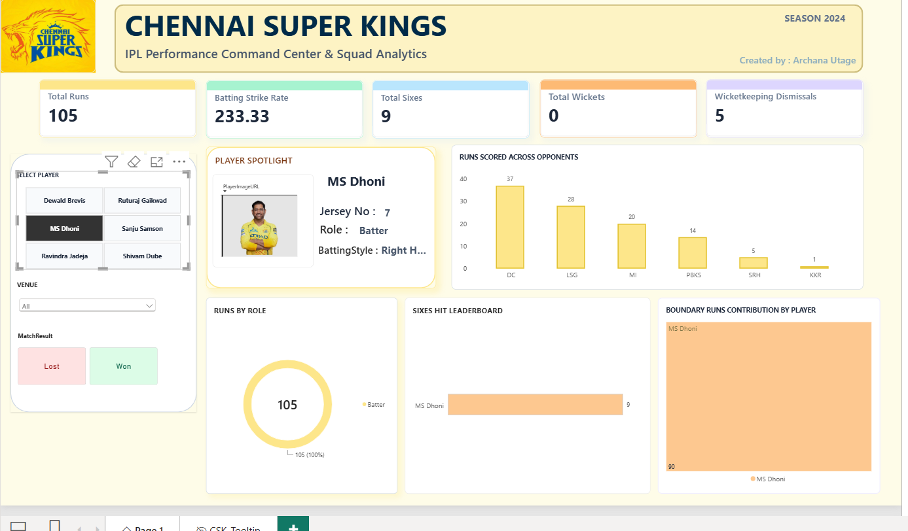

# Chennai Super Kings (CSK) — IPL Analytics Command Center

An interactive Power BI analytics dashboard tracking squad metrics, match outcomes, and boundary contribution trends for Chennai Super Kings across the 2024 IPL season.

## 📸 Dashboard Preview



## Key Features & Dashboard Highlights

- **Executive KPI Cards**: Real-time aggregation of Total Runs, Batting Strike Rate, Sixes, Wickets, and Wicketkeeping Dismissals.
- **Dynamic Player Spotlight**: Slicer-driven player card dynamically updating player portraits, jersey numbers, and playing roles.
- **Interactive Hover Video Tooltip**: Custom report page tooltip integrated with an event-sensor overlay on the CSK crest, triggering an instant match animation pop-up on cursor hover without cluttering canvas real estate.
- **Zero-Repetition Visual Analytics**:
  - **Runs Scored Across Opponents**: Clustered column chart with direct data labels.
  - **Runs by Role**: Multi-category donut chart for role-based run distribution.
  - **Sixes Hit Leaderboard**: Horizontal bar chart highlighting primary power hitters.
  - **Boundary Dominance**: Proportional treemap visual analyzing individual boundary run contributions.
- **Interactive Slicers & State Toggles**:
  - Contextual **Won** (`#DCFCE7`) and **Lost** (`#FEE2E2`) button toggles.
  - Multi-season and Stadium/Venue dropdown filtering.

##  Data Architecture (Star Schema)

The dashboard model is structured around a normalized Star Schema:

- **`Fact_Performance`**: Contains match-level performance statistics (Runs, Fours, Sixes, Wickets, Dismissals).
- **`Dim_Player`**: Stores player master attributes (`PlayerID`, `PlayerName`, `Role`, `JerseyNumber`, `PlayerImageURL`).
- **`Dim_Match`**: Stores match context (`MatchID`, `MatchDate`, `Opponent`, `Venue`, `SeasonYear`, `MatchResult`).

### Relationships:
- `Dim_Player[PlayerID]` (1) ───< (*) `Fact_Performance[PlayerID]`
- `Dim_Match[MatchID]` (1) ───< (*) `Fact_Performance[MatchID]`

## Key DAX Measures & Formulas

```dax
// Dynamic Jersey Display
Selected Jersey = SELECTEDVALUE('Dim_Player'[JerseyNumber], 7)

// Boundary Runs Calculated Column
BoundaryRuns = ('Fact_Performance'[Fours] * 4) + ('Fact_Performance'[Sixes] * 6)

// Slicer Button Conditional Formatting
Result Button Color = 
SWITCH(
    SELECTEDVALUE('Dim_Match'[MatchResult]),
    "Won", "#DCFCE7",
    "Lost", "#FEE2E2",
    "#FFFFFF"
)
